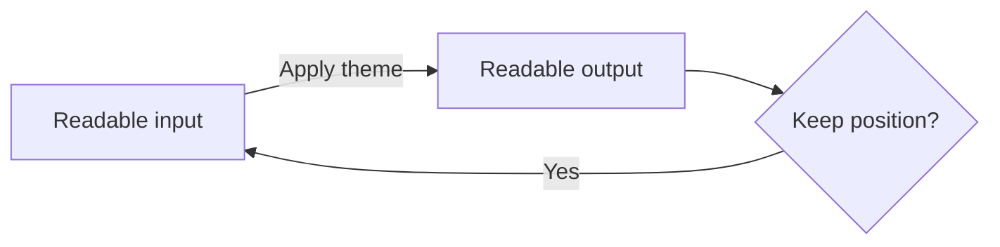
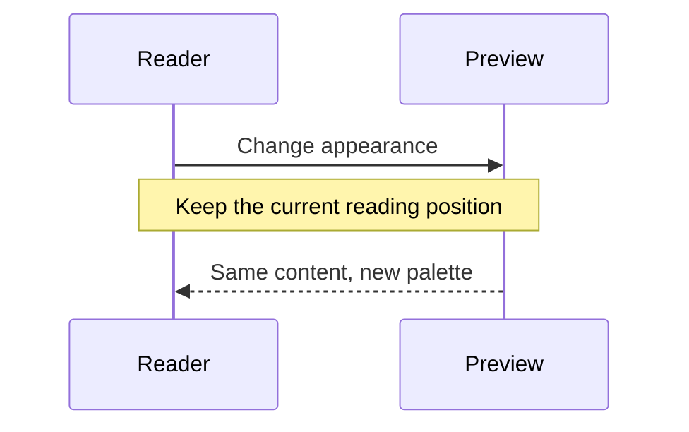

<!-- SPDX-FileCopyrightText: 2026 OPPO -->
<!-- SPDX-License-Identifier: Apache-2.0 -->

# Theme surface acceptance

This document has readable prose, [a link](#reading-position), **strong text**, and `inlineCode(42)`.

> A muted quotation must remain readable in both appearances.

```typescript
// A comment is meaningful text, not decorative background.
interface Palette { name: string; count: number }
const palette: Palette = { name: "surface-check", count: 42 }
function describe(value: Palette): string {
  return `${value.name}: ${value.count + 1}`
}
console.log(describe(palette))
```





## Reading position

Paragraph 01. A theme change should preserve this document and the user's place within it.

Paragraph 02. The selected code, diagram labels, and reading controls should remain legible.

Paragraph 03. Dark and light use appropriate foreground colors rather than inverted content.

Paragraph 04. Search highlights must distinguish the current result from surrounding prose.

Paragraph 05. Repeated appearance changes should not add new listeners or stylesheets.

Paragraph 06. A preview should not be reparsed just to repaint syntax colors.

Paragraph 07. A diagram should keep its current pan and zoom when its palette changes.

Paragraph 08. The same contracts apply to restored and newly opened content.

Paragraph 09. The file browser and outline should remain usable at a narrow panel width.

Paragraph 10. Contrast is measured against the actual composited background.

Paragraph 11. Existing web and image content keeps its authored colors.

Paragraph 12. PDF enhancement is a reading choice separate from application appearance.

Paragraph 13. EPUB keeps its reader typography and selected chapter.

Paragraph 14. A theme update should not discard an editor selection or undo history.

Paragraph 15. Git additions and deletions need both readable text and distinct indicators.

Paragraph 16. The current frame and document should survive an appearance update.

Paragraph 17. This marker provides a stable lower-document scroll destination.

## Final marker

THEME_SURFACES_READING_END
